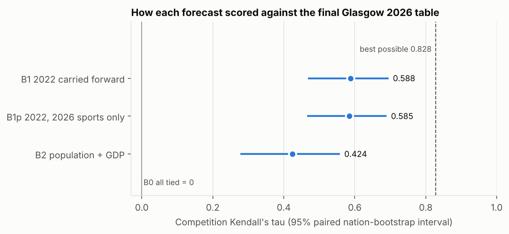
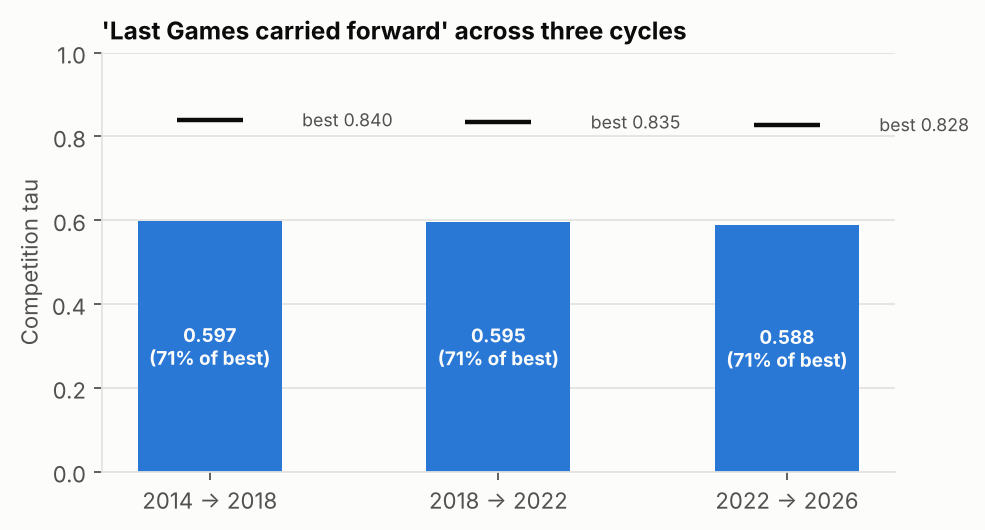
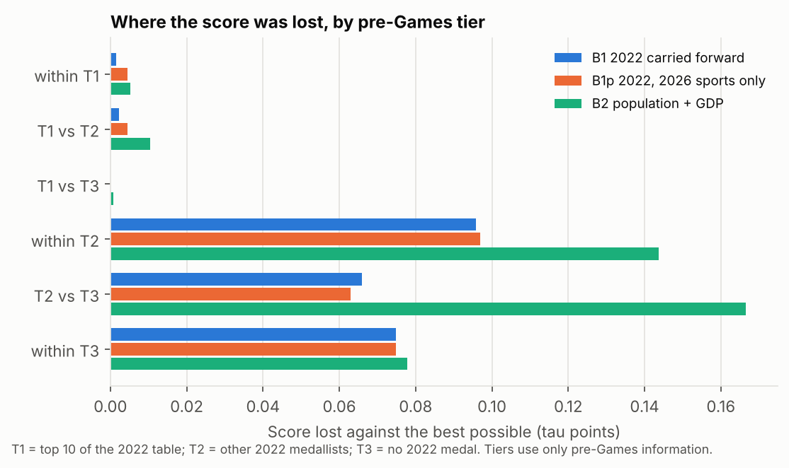
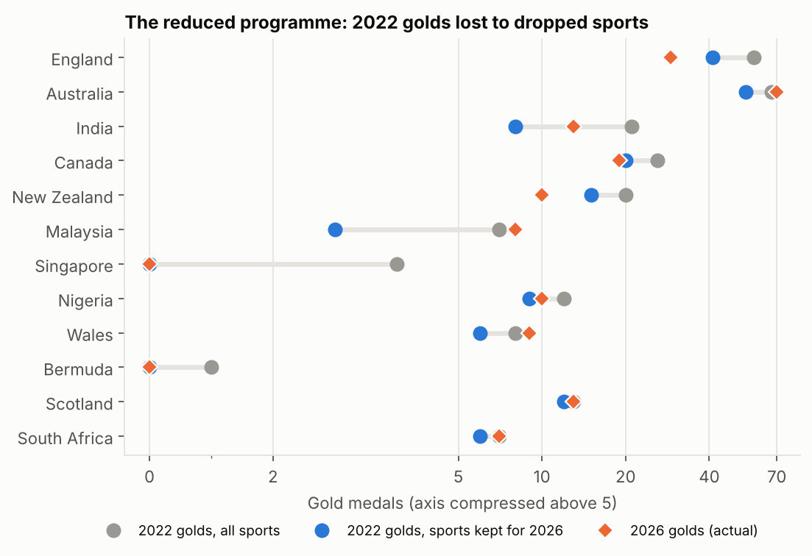
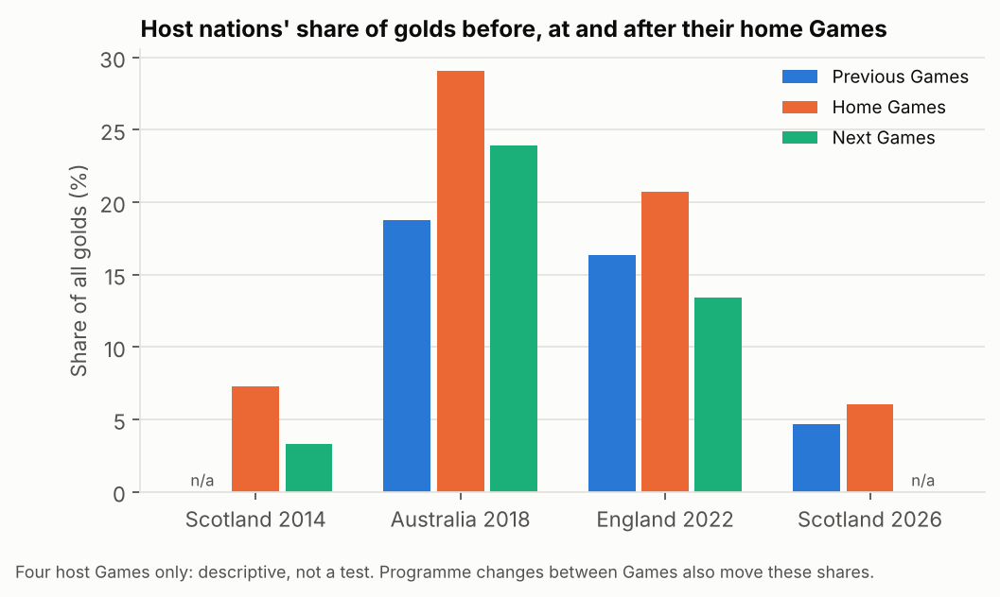

# Glasgow 2026 medal-table forecast: post-mortem

> **Status:** baselines only. The original pre-registered forecast has not been added yet, so this report does not score it. See section 6.

This report is generated by `python -m cgpm.pipeline`; every number below is computed, not typed. The plan it follows was committed before any scoring (`ANALYSIS_PLAN.md`), and the leakage controls are listed in `LEAKAGE_AUDIT.md`.

## 1. Summary

- The best possible score this year was **0.828**, not 1. 464 of the 2701 pairs of nations finished level (mostly among the 29 nations with no medal), and the rules score a tied pair as zero whatever the forecast says.
- Carrying the Birmingham 2022 table forward (B1) scored **0.588** (95% interval [0.468, 0.695]), 71% of the best possible.
- The population + GDP model (B2) scored **0.424** ([0.278, 0.558]). B1 (2022 carried forward) beats B2 (population + GDP) (difference 0.164, 95% paired interval [0.043, 0.288]).
- Adjusting 2022 for the reduced programme (B1p) scored **0.585**. B1p (2022, 2026-programme sports only) and B1 (2022 carried forward) are not distinguishable on this data (difference -0.003, 95% paired interval [-0.026, 0.020]). Dropping the sports that were cut did not, on its own, sharpen the forecast.
- 2026 was not unusually hard to forecast: the same carry-forward method reached 71.1% of the best possible in 2018, 71.4% in 2022 and 71.0% in 2026.
- Almost all the lost score is among smaller nations. B1 lost 0.240 points against the ceiling; only 0.004 of that came from pairs involving the 2022 top ten.

## 2. Setup

**Truth.** Final Glasgow 2026 table, ranked by gold, then silver, then bronze, with nations level on all three left tied (the competition rules). All 74 participating CGAs are included.

**Metric.** The competition's Kendall's tau: concordant minus discordant pairs, divided by all 2701 pairs. Tied pairs count zero but stay in the denominator. This is not scipy's tau-b, which is shown only for reference.

**Uncertainty.** A paired nation bootstrap (10,000 resamples, seed 20260722) that drops self-pairs, and a permutation test (10,000 shuffles). The bootstrap measures how much the score depends on which nations are compared. It does **not** measure sporting luck inside the Games (see section 7).

## 3. Scores



| Forecast | tau | 95% interval | Share of best possible | Concordant / discordant pairs | Permutation p | tau-b (reference only) |
|---|---|---|---|---|---|---|
| B0 default entry (all tied) | 0.000 | [0.000, 0.000] | 0% | 0 / 0 | n/a | n/a |
| B1 Birmingham 2022 carried forward | 0.588 | [0.468, 0.695] | 71% | 1804 / 216 | < 0.001 | 0.713 |
| B1p 2022, 2026-programme sports only | 0.585 | [0.466, 0.690] | 71% | 1795 / 216 | < 0.001 | 0.714 |
| B2 population + GDP model | 0.424 | [0.278, 0.558] | 51% | 1691 / 546 | < 0.001 | 0.466 |

All informative forecasts beat a random ordering with the same ties (permutation p < 0.001).

**Paired comparisons** (decision rule: a forecast "beats" another only if the 95% paired interval excludes zero):

| Comparison | Difference in tau | 95% paired interval | Verdict (decision rule) |
|---|---|---|---|
| B1p - B1 | -0.003 | [-0.026, 0.020] | not distinguishable |
| B1 - B2 | 0.164 | [0.043, 0.288] | B1 beats B2 |
| B1p - B2 | 0.161 | [0.038, 0.288] | B1p beats B2 |

### B2 in detail

Poisson regression of gold medals on log population and log GDP, with a fixed effect per Games, fitted on the 2018 and 2022 Games (143 nation-Games rows). Nothing was tuned on 2026.

- Coefficient on log GDP: **0.996** (quasi-Poisson SE 0.059).
- Coefficient on log population: **-0.320** (SE 0.054).

Holding GDP fixed, more people means fewer golds: what the model really rewards is wealth per head. The counts are over-dispersed (Pearson dispersion 2.56), so quasi-Poisson standard errors are reported. Over-dispersion does not affect the point estimates, which are all the ranking uses.

2026 GDP was imputed by the pre-specified rule for Norfolk Island, Saint Helena only.

## 4. Was 2026 unusually hard?



Scoring "last Games carried forward" in earlier cycles, using only pre-2026 tables:

| Forecast | Target Games | tau | Best possible | Share of best |
|---|---|---|---|---|
| 2014 table carried forward | 2018 | 0.597 | 0.840 | 71% |
| 2018 table carried forward | 2022 | 0.595 | 0.835 | 71% |
| 2022 table carried forward (B1) | 2026 | 0.588 | 0.828 | 71% |

Despite a programme cut to 10 sports, the naive forecast did about as well as it did in normal cycles. The benchmark any method has to beat is therefore roughly 0.59, and about 70% of the best achievable.

## 5. Where the forecasts went wrong

### 5.1 Pre-Games tiers: the error is in the small nations

Tiers come from the 2022 table only (T1 = top 10, T2 = other 2022 medallists, T3 = no 2022 medal), so they cannot be chosen to flatter a forecast.



| Pairs | Number | Tied in truth | B1 tau within | B2 tau within | B1 score lost | B2 score lost |
|---|---|---|---|---|---|---|
| within T1 top-10 in 2022 | 45 | 0% | 0.911 | 0.689 | 0.001 | 0.005 |
| T1 top-10 in 2022 vs T2 other 2022 medallists | 330 | 0% | 0.982 | 0.915 | 0.002 | 0.010 |
| T1 top-10 in 2022 vs T3 no 2022 medal | 310 | 0% | 1.000 | 0.994 | 0.000 | 0.001 |
| within T2 other 2022 medallists | 528 | 6% | 0.449 | 0.205 | 0.096 | 0.144 |
| T2 other 2022 medallists vs T3 no 2022 medal | 1023 | 17% | 0.661 | 0.395 | 0.066 | 0.167 |
| within T3 no 2022 medal | 465 | 57% | 0.000 | -0.017 | 0.075 | 0.078 |

The 2022 top ten are close to solved by B1 and largely by B2. The score is lost in three places:

- **Among the mid-ranked medallists (within T2)**, whose rankings reshuffle from one Games to the next.
- **Between T2 and T3**, where a nation without a 2022 medal overtook one that had one.
- **Within T3**, where B1 ties every nation without a 2022 medal and so cannot score any of their pairs.

That is the "small-nation noise": one bronze or one gold moves a small nation 10 to 20 places.

### 5.2 Biggest individual misses

Nations with the most pairs placed in the wrong order (discordant), out of their 73 pairs.

**B1:**

| Nation | Forecast rank | True rank | Concordant | Discordant | Net |
|---|---|---|---|---|---|
| Jersey | 44 | 17 | 16 | 25 | -9 |
| Isle of Man | 44 | 20 | 18 | 23 | -5 |
| Pakistan | 18 | 36 | 46 | 18 | 28 |
| Mozambique | 30 | 46 | 29 | 16 | 13 |
| Tanzania | 32 | 46 | 30 | 15 | 15 |
| Botswana | 33 | 46 | 30 | 14 | 16 |

**B2:**

| Nation | Forecast rank | True rank | Concordant | Discordant | Net |
|---|---|---|---|---|---|
| Samoa | 61 | 17 | 29 | 42 | -13 |
| Dominica | 65 | 23 | 31 | 40 | -9 |
| Bangladesh | 11 | 46 | 10 | 35 | -25 |
| Grenada | 55 | 23 | 38 | 33 | 5 |
| Nauru | 68 | 33 | 38 | 33 | 5 |
| British Virgin Islands | 51 | 23 | 41 | 30 | 11 |

**B1's worst misses.** Jersey and the Isle of Man won no medal in 2022, so B1 tied them at the bottom. In 2026 they won a gold each and finished 17th and 20th.

**B2's worst misses** are nations that its income model rates highly but that won nothing (e.g. Bangladesh), and small, poorer nations that won a gold (e.g. Samoa, Dominica).

### 5.3 The reduced programme



Of the 280 golds won in 2022, 70 came in sports that were not held in 2026.

| Nation | 2022 golds | ...in 2026 sports | ...in dropped sports | Share dropped | 2026 golds | B1 rank | B1p rank | True rank |
|---|---|---|---|---|---|---|---|---|
| England | 58 | 41 | 17 | 29% | 29 | 2 | 2 | 2 |
| Australia | 67 | 54 | 13 | 19% | 70 | 1 | 1 | 1 |
| India | 21 | 8 | 13 | 62% | 13 | 4 | 7 | 4 |
| Canada | 26 | 20 | 6 | 23% | 19 | 3 | 3 | 3 |
| New Zealand | 20 | 15 | 5 | 25% | 10 | 5 | 4 | 6 |
| Malaysia | 7 | 3 | 4 | 57% | 8 | 10 | 13 | 10 |
| Singapore | 4 | 0 | 4 | 100% | 0 | 14 | 28 | 28 |
| Nigeria | 12 | 9 | 3 | 25% | 10 | 7 | 6 | 7 |

The cut was uneven: India lost 62% of its 2022 golds and Singapore 100%, against 19% for Australia.

Removing them changed 64 pairs:

- 20 went from discordant to concordant.
- 27 went the other way.
- The rest moved to or from ties.

The net effect was nil because the programme adjustment over-corrected in places. India, for example, was ranked lower by B1p, but its boxers won far more in 2026 than in 2022, and India finished fourth, exactly where B1 had it. Knowing which sports were dropped is real information, but past medals within the remaining sports were not a better guide than the full 2022 table.

### 5.4 Host effect



Scotland's share of golds went from 4.6% in 2022 to 6.0% at home. Earlier hosts showed a similar pattern:

- Australia: 18.8% to 29.1% in 2018.
- England: 16.4% to 20.7% in 2022, then down to 13.4% away from home.

With four hosts this is description, not evidence. Programme changes between Games (here, which sports were kept) move shares as well.

For the ranking, the host effect barely mattered. Scotland finished 5th; the forecasts placed it 6th (B1), 5th (B1p), 6th (B2).

## 6. The original submission

**Not yet added.** The original CSV is not in this repository, so this report scores the baselines only. Every comparison with the original appears automatically once `data/forecast/original_submission.csv` is added (see `data/forecast/README.md`). The baselines' numbers will not change, because they never depend on it.

## 7. Limitations

- **No sporting-luck interval.** The bootstrap resamples nations, not events. An interval reflecting the luck of individual finals would need event-by-event results for all 215 events, which this repository does not contain.
- **Programme filter is sport-level.** B1p keeps whole sports and does not adjust for events dropped within a sport (athletics, for example, changed slightly between Games).
- **GDP data quality for tiny territories.** Factbook figures have mixed reference years, Jersey and Guernsey share one combined figure split by population, and two territories' GDP is imputed. All of this was fixed by rule before scoring, and these nations carry little weight either way.
- **Home-nation split.** The four home nations are the UK figure times ONS 2023 shares, applied to every snapshot. The shares move slowly, and they are not outcome data, so this cannot leak results. It is still an approximation for 2018 and 2022.
- **Medal-table transcription.** Medal tables were transcribed from Wikipedia. Every table's totals are checked against the published totals by the test suite, and the 2026 top six against an independent source, but individual rows could still carry a transcription error.
- **Retrospective baselines.** B1p and B2 were specified after the Games (using only pre-deadline data), so a sceptic can ask whether they were chosen knowing how they would do. The mitigations: B1 and B2 come from the project brief, B1p is a decomposition device rather than a competitor, and the plan was committed before the first score.

## 8. Reproduce

```
pip install -r requirements.txt
make all        # tests, then the full pipeline
```

`make data` re-extracts the Factbook features (needs git and network access). Everything else runs offline from the committed data.
